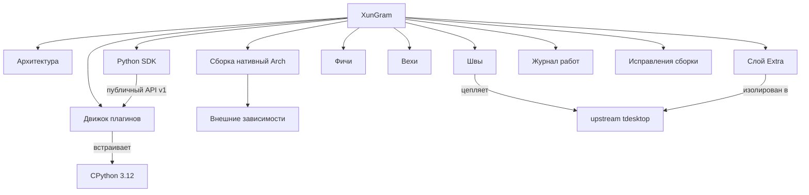

# XunGram — карта проекта

ПК-форк [[tdesktop]] с открытой системой плагинов на Python и набором доп-фич.
Рабочее имя — **XunGram** (плейсхолдер).

## Что это
- База: [[tdesktop]] 7.3.1 (Qt6, C++20, GPLv3).
- Движок плагинов: [[Python SDK]] поверх встроенного CPython — см. [[Движок плагинов]].
- Изоляция кода: свой слой [[Слой Extra]] + [[Швы]] в апстрим.
- Фичи и вехи: [[Вехи]], [[Фичи]].

## Навигация
- [[Архитектура]]
- [[Слой Extra]]
- [[Движок плагинов]]
- [[Python SDK]]
- [[Швы]]
- [[Фичи]]
- [[Вехи]]
- [[Сборка нативный Arch]]
- [[Внешние зависимости]]
- [[Журнал работ]]
- [[Исправления сборки]]

**2D-граф (Canvas):** [[Граф.canvas]]

## Общая схема

## Быстрый статус
- **Готово:** спецификация, план по [[Вехи|вехам]], слой [[Слой Extra]], два [[Швы|шва]],
  [[Python SDK]] (8 тестов проходят), примеры плагинов `hello`/`translate`.
- **В работе:** нативная сборка на Arch — см. [[Исправления сборки]] и [[Внешние зависимости]].
- **Заблокировано:** сборка [[tg_owt]] (WebRTC) — тяжёлая, ещё не собрана.

## Юридически важно
- Свой `api_id`/`api_hash` с my.telegram.org.
- Своё имя/логотип/app-id; нельзя выдавать за официальный Telegram.
