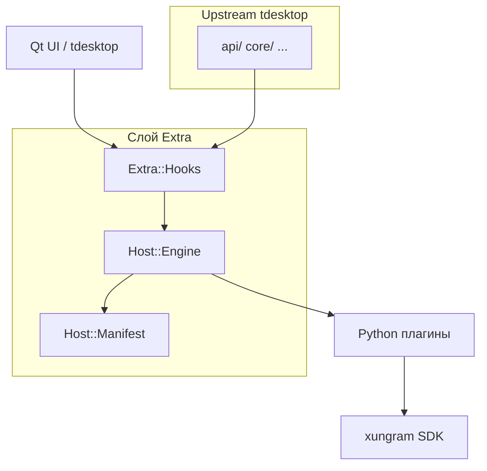

# Архитектура

Связь: [[XunGram]] · слой кода → [[Слой Extra]] · стыки → [[Швы]] · движок → [[Движок плагинов]].

## Принцип
Форк [[tdesktop]] + **изолированный слой** `extra/`, который регулярно мержится с upstream.
Плагины на Python работают **в процессе** (без песочницы) с максимальной властью.

## Слои


## Подход C (гибрид)
- Hot-path фичи — на C++ (производительность).
- Кастомизация — Python-плагинами через публичный API v1.

## Раскладка
```
tdesktop/Telegram/SourceFiles/extra/
  extra.h / extra.cpp     # Extra::Initialize()
  seam/                   # швы в upstream (hooks)
  host/                   # манифесты + движок
  features/               # C++ фичи (позже)
  ui/                     # UI-менеджер плагинов (позже)
```

## Связанные заметки
- [[Слой Extra]]
- [[Движок плагинов]]
- [[Швы]]
- [[Вехи]]
