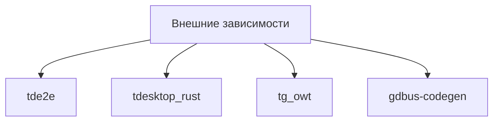

# Внешние зависимости

Часть [[Сборка нативный Arch]]. Telegram-специфичные библиотеки, которых нет в Arch —
их нужно собрать самому (в Docker их собирают заранее).

| Зависимость | Источник | Статус |
|---|---|---|
| [[tde2e]] | `tdlib/td` (TD_E2E_ONLY) | ✅ собран |
| [[tdesktop_rust]] | tlottie + wallet-engine (Rust) | ✅ собран |
| [[tg_owt]] | `desktop-app/tg_owt` (WebRTC) | ✅ собран |
| [[gdbus-codegen]] | исходники `GNOME/glib` 2.82.2 | ✅ собран |

## Почему их нет в системе
`DESKTOP_APP_USE_PACKAGED` ищет их через `find_package`/`find_library`, но Arch не
пакует эти Telegram-компоненты. Поэтому CMake падал по одному:
Boost → tde2e → wallet_engine → tg_owt → gdbus-codegen (см. [[Исправления сборки]]).

## Связанные заметки
- [[tde2e]]
- [[tdesktop_rust]]
- [[tg_owt]]
- [[gdbus-codegen]]
- [[Исправления сборки]]
