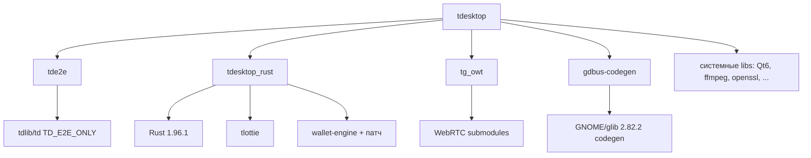

# Сборка нативный Arch

Без Docker. Связано: [[Внешние зависимости]], [[Исправления сборки]].

## Ключевой момент
Папки `../Libraries` нет → CMake **сам** включает `DESKTOP_APP_USE_PACKAGED=ON`
(`cmake/validate_special_target.cmake:16`), сборка идёт против системных библиотек.
Сабмодули уже инициализированы. Скачивать «Libraries» с серверов Telegram не нужно.

## Путь без пробелов
Проект лежит в `/home/xunkal1/telegram-client` (без пробела). Старое имя
`/home/xunkal1/telegram client` оставлено symlink'ом для совместимости.

Причина: `g-ir-scanner` создаёт временный каталог через
`tempfile.mkdtemp(dir=os.getcwd())` (`giscanner/dumper.py`), а `os.getcwd()`
всегда возвращает **физический** путь. Symlink не помогает — ядро
канонизирует путь обратно, и пробел снова ломает `libtool`/`gcc`
(`input file '/home/xunkal1/telegram' is the same as output file`).
Поэтому переименована сама папка, а на старое имя положен symlink.

## Инструменты
```bash
sudo pacman -S --needed cmake ninja ccache gperf \
  boost nasm perl-xml-parser vulkan-headers xorg-util-macros
```

## Внешние (собрать самому)
См. [[Внешние зависимости]]: [[tde2e]], [[tdesktop_rust]], [[tg_owt]].
Установлены в локальные префиксы:
- `/home/xunkal1/telegram-client/.deps/tde2e` ✅
- `/home/xunkal1/telegram-client/.deps/tdesktop_rust` ✅
- `/home/xunkal1/telegram-client/.deps/tg_owt` ✅
- `/home/xunkal1/telegram-client/.deps/gdbus-codegen` ✅ (из исходников GNOME/glib, см. [[Исправления сборки]])

## Configure
```bash
cmake -S tdesktop -B out -G Ninja \
  -D CMAKE_BUILD_TYPE=Debug \
  -D DESKTOP_APP_USE_PACKAGED=ON \
  -D CMAKE_PREFIX_PATH="/home/xunkal1/telegram-client/.deps/tde2e;/home/xunkal1/telegram-client/.deps/tdesktop_rust;/home/xunkal1/telegram-client/.deps/tg_owt" \
  -D DESKTOP_APP_GDBUSCODEGEN="/home/xunkal1/telegram-client/.deps/gdbus-codegen/bin/gdbus-codegen" \
  -D TDESKTOP_API_ID=<id> -D TDESKTOP_API_HASH=<hash>
cmake --build out -j$(nproc)
```
Статус: **configure ✅** (2026-10-12), идёт `cmake --build` (2292 шага, `-j3` из-за 4 ГБ RAM).

## Граф зависимостей сборки


## Связанные заметки
- [[Внешние зависимости]]
- [[Исправления сборки]]
- [[Журнал работ]]
