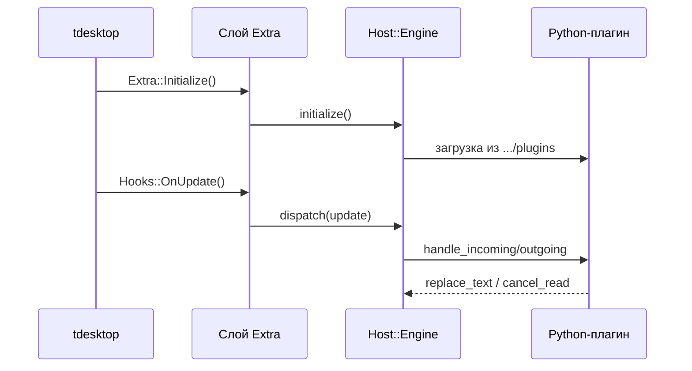

# Движок плагинов

Часть [[Архитектура]]. Реализует [[Python SDK|API v1]] внутри процесса.

## Идея

## Решения
- Встроенный **CPython 3.12** + **pybind11**.
- In-process, **без песочницы** (максимальная власть).
- Изоляция ошибок плагина (ошибка плагина не валит клиент) + safe mode — [[Вехи|M1.3]].
- `kApiVersion = 1`.

## Статус
- C++: [[Слой Extra|host/manifest + host/engine]] — есть.
- Python-бэкенд (CPython-встраивание) — [[Вехи|M1.1]], пока нет (pybind11 не вендорен).

## Связанные заметки
- [[Python SDK]]
- [[Слой Extra]]
- [[Швы]]
