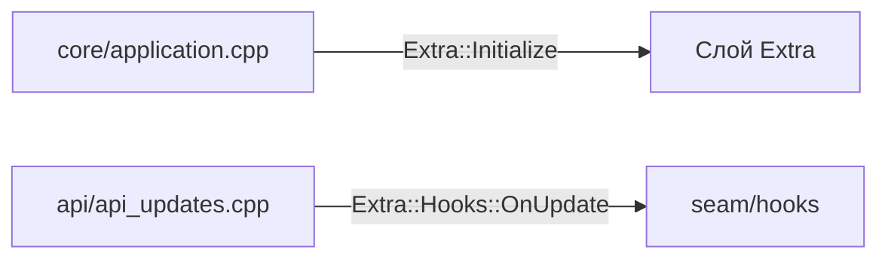

# Швы

Часть [[Слой Extra]]. Реестр в файле `SEAMS.md` (корень проекта).
Формат записи: `файл → якорь → вызов → назначение → как проверить`.

## Что задето в upstream

## seam.update-dispatch
- **Файл:** `tdesktop/Telegram/SourceFiles/api/api_updates.cpp`
- **Якорь:** `Api::Updates::mtpUpdateReceived`
- **Вызов:** `Extra::Hooks::OnUpdate();` (первая строка)
- **Назначение:** вход входящих апдейтов (главный поток).
- **ПроверКА:** лог `XunGram: update hook active` один раз.
- **Примечание:** сейчас `OnUpdate()` без параметров; полезная нагрузка (`MTPUpdates`) — на [[Вехи|вехе M2.1]].

## seam.app-startup
- **Файл:** `tdesktop/Telegram/SourceFiles/core/application.cpp`
- **Якорь:** `Core::Application::run()`, после `Storage::ClearStaleArchiveFiles();`
- **Вызов:** `Extra::Initialize();`
- **Назначение:** однократная инициализация слоя на главном потоке.
- **Проверка:** лог `XunGram: found N plugin(s)`.
- **Зависимости:** `extra/extra.h` → `extra/host/engine.*` → `extra/host/manifest.*`.

## Связанные заметки
- [[Слой Extra]]
- [[Движок плагинов]]
- [[Журнал работ]]
